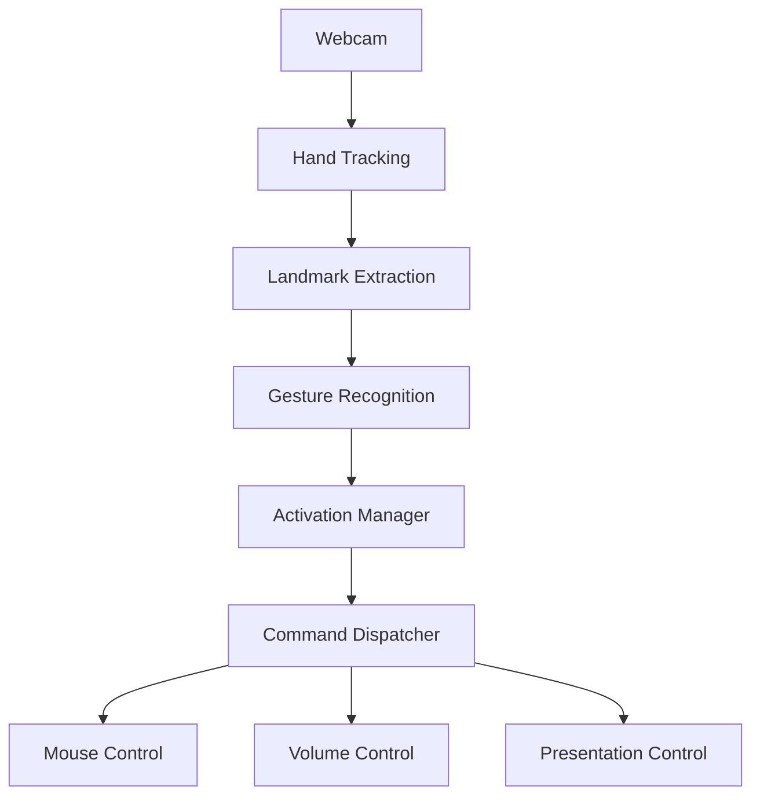

# 🖐️ Hand Gesture Control

Control your computer using nothing but your hand and a webcam.

A practical demonstration of computer-vision-driven human-computer interaction with both a browser demo and a desktop control system. The project focuses on real-time hand tracking, gesture interpretation, safety gating, and OS-level automation without relying on fake or placeholder logic.


## Overview

This repository contains two modes:

1. A browser-based demo that uses the webcam locally in the browser and simulates pointer, presentation, and volume interactions without sending frames to a backend.
2. A Python desktop application that captures camera frames locally and executes actual mouse, volume, and presentation controls on the host machine.

The project is designed to be a serious portfolio project for machine learning, computer vision, and product engineering work.

## Demo

The web demo is fully local and runs inside the browser. It uses MediaPipe Hands, local webcam access, and simulated UI controls to demonstrate the concept.

## Features

- Webcam access with explicit permission checks
- Hand landmark detection using MediaPipe Hands
- Real-time gesture recognition and confidence tracking
- Activation gate using an open palm hold duration
- Mouse control with smoothing, custom sensitivity, and safe dead-zone handling
- System volume adjustment
- Presentation slide navigation with keyboard events
- Browser simulation of cursor, volume, and slide interactions
- Structured configuration and clean separation of responsibilities
- Documentation and tests for geometry, recognition, activation, and smoothing

## Gesture Controls

| Gesture | Action |
| --- | --- |
| 👍 Thumbs Up | Volume Up |
| 👎 Thumbs Down | Volume Down |
| ✌️ Two Fingers | Next Slide |
| ☝️ One Finger | Previous Slide |
| 🖱️ Index Tip Movement | Move Cursor |
| 🤏 Pinch | Click |
| 🖐️ Open Palm | Activate / Safety Gesture |

## Architecture



## Tech Stack

- Python 3.11+
- OpenCV
- MediaPipe
- NumPy
- PyAutoGUI
- JavaScript + HTML + CSS
- Browser webcam APIs
- pytest for automated checks

## Installation

### Desktop version

```bash
python -m venv .venv
source .venv/bin/activate
pip install -r requirements.txt
python main.py
```

### Web demo

```bash
cd web
python -m http.server 8000
```

Then open:

```text
http://localhost:8000/
```

## Usage

### Desktop control app

1. Launch the app.
2. Hold your open palm for about 1.5 seconds to activate the system.
3. Use gestures to control volume, cursor movement, slide changes, and clicks.
4. Remove the open palm or stop tracking to return to the inactive state.

### Browser demo

1. Open the web demo in a browser.
2. Allow webcam permission.
3. Watch the recognition results and the simulated control panel respond.
4. Note that browser security prevents direct OS control of the real mouse and keyboard.

## Configuration

The central configuration is in [config.py](config.py). It includes values for:

- camera index
- activation timing
- gesture confidence thresholds
- cursor sensitivity and smoothing
- pinch threshold
- volume adjustment
- presentation key mapping
- display and camera resolution

## Web Demo Limitations

A normal browser page cannot directly control the actual operating system mouse, keyboard, or system volume because of browser security restrictions. The web demo therefore simulates actions locally in the browser only. Camera frames never leave the machine.

The browser demo is a static client-side application; it does not call a Python backend. The Python desktop app is a separate local process launched with `python main.py` and is not an API server for the web page.

## Desktop Version

The desktop version is meant for real host control. It is designed to work with standard operating system input APIs where available. On Linux, volume control is implemented with system audio utilities when present. On Windows, volume control may rely on OS-specific APIs. This is isolated behind a controller layer so it can be extended cleanly.

## Supported Operating Systems

- Linux: supported for camera capture and local automation with local system controls where available.
- Windows: supported for desktop automation and volume control through OS-specific integrations.
- macOS: can be extended with additional handlers; the current repository focuses on a clear architecture for cross-platform adaptation.

## Troubleshooting

Common problems include:

- camera permission blocked
- no usable webcam interface
- no hand detected
- multiple hands in view
- missing dependencies
- unsupported display environment
- volume backend unavailable

See [docs/troubleshooting.md](docs/troubleshooting.md) for detailed guidance.

## Privacy

- Camera processing is local to the device.
- The web demo never uploads webcam frames to a backend.
- The desktop app does not transmit frames anywhere by default.

## Security

- The project intentionally avoids unsafe automation outside the user’s local environment.
- All camera access is user-approved.
- The activation gate prevents accidental commands when the system is not intentionally armed.

## Future Improvements

- multi-hand recognition
- custom gesture macros
- voice and gesture hybrid control
- media-player control
- browser navigation gestures
- personalized calibration and AI-enhanced recognition
- mobile and smart-TV support

## Contributing

Contributions are welcome. Please open an issue before large changes, keep the implementation clean, and add tests when altering the gesture logic or configuration behavior.

## License

This project is licensed under the MIT License. See [LICENSE](LICENSE).

## Repository Structure

```text
hand-gesture-control/
├── README.md
├── LICENSE
├── .gitignore
├── requirements.txt
├── requirements-dev.txt
├── config.py
├── main.py
├── src/
│   ├── __init__.py
│   ├── gesture_controller.py
│   ├── camera/
│   │   ├── __init__.py
│   │   └── camera_manager.py
│   ├── vision/
│   │   ├── __init__.py
│   │   ├── hand_tracker.py
│   │   └── gesture_recognizer.py
│   ├── controllers/
│   │   ├── __init__.py
│   │   ├── mouse_controller.py
│   │   ├── volume_controller.py
│   │   └── presentation_controller.py
│   ├── safety/
│   │   ├── __init__.py
│   │   └── activation_manager.py
│   └── utils/
│       ├── __init__.py
│       ├── geometry.py
│       └── smoothing.py
├── web/
│   ├── index.html
│   ├── styles.css
│   └── app.js
├── docs/
│   ├── architecture.md
│   ├── gestures.md
│   └── troubleshooting.md
├── tests/
│   ├── test_activation.py
│   ├── test_geometry.py
│   ├── test_gestures.py
│   └── test_smoothing.py
└── screenshots/
```

## Notes

This repository is intentionally structured to separate:

- computer vision processing
- gesture logic
- activation safety checks
- command execution
- browser-only simulation

This keeps the system maintainable, testable, and suitable for real engineering demos.
